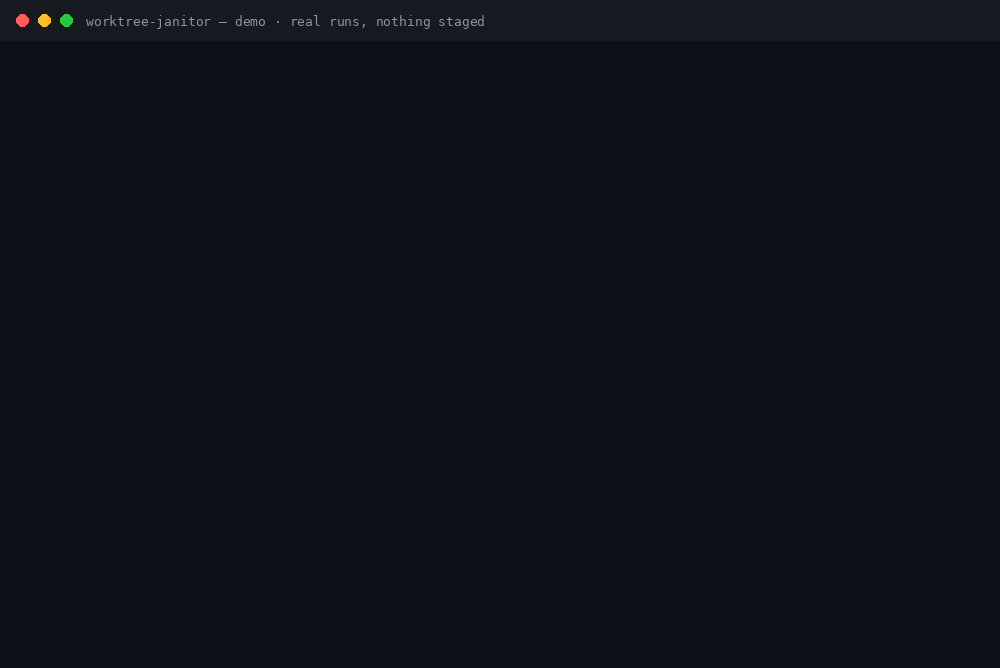

<h1 align="center">worktree-janitor</h1>

<p align="center"><strong>Stale worktrees pile up. Clean up without the fear — an inventory that judges every one, and a plan that never runs itself.</strong></p>

<p align="center">
  
  
  
  
  
</p>

<p align="center"></p>

Parallel agents leave worktrees behind like coat
hangers. Every AI coding session that runs in its own
git worktree leaves the worktree behind when it ends —
headless runs leave theirs *locked*. A forgotten
worktree pins its branch, holds a folder of disk, and
may contain the only copy of some piece of work. So the
pile grows: nobody deletes blindly (that loses work),
nobody keeps track (that was the manual part), and
`git worktree list` gets longer every week.

worktree-janitor is the audit step that makes cleanup
safe. One read-only pass asks git — and only git — for
the facts about every worktree and local branch: dirty
or clean, uncommitted and untracked file counts, merged
into the default branch or not, unpushed commits,
last-commit age, locked and prunable state. Each
worktree gets a verdict with its reasons printed:
**SAFE_TO_REMOVE**, **REVIEW**, or **KEEP**. Then the
`plan` subcommand prints the exact cleanup commands —
and never runs them. There is no code path from the
plan to a shell; the commands are output text, and
running them (or not) is your decision.

**Read-only, enforced in code — not just promised.**
Every git invocation funnels through one gate that
refuses, before git starts, any argv carrying a
mutating verb or flag (`remove`, `prune`, `checkout`,
`clean`, `-d`, `--force`, …). The only commands ever
run are git's read-only queries, and all of them run
with `GIT_OPTIONAL_LOCKS=0`, so git does not even
refresh the index. The test suite proves it two ways:
every subprocess argv of a full scan + plan run is
recorded and asserted against the allowlist, and the
fixture repo's full state is byte-identical before and
after. The demo above ends the way every run does —
`git worktree list` afterwards, all six worktrees
still standing.

## Quick start

```bash
pipx install git+https://github.com/jasveerai88/worktree-janitor           # or: pip install git+https://github.com/jasveerai88/worktree-janitor
worktree-janitor scan                   # judge the repo you're standing in
worktree-janitor plan                   # the exact commands — printed, never run
```

That's the whole workflow: one pass, verdicts with
reasons, an exit code you can gate on — **0** = nothing
to clean, **1** = cleanup candidates or REVIEW items
exist, **2** = error. `DIR` can be any folder inside
any worktree; git resolves the whole repo from it. Add
`--json` for the same facts as one JSON object, and
`--stale-days N` to tune when a merged branch counts
as stale (default 30). From a source checkout,
`python3 src/worktree_janitor.py scan` does the same
thing. Python 3.10+, standard library only, no
dependencies. No repo you dare point it at? The
bundled sample builds the exact sprawl in the demo:

```bash
python3 examples/make_sample.py /tmp/worktree-janitor-demo
worktree-janitor scan /tmp/worktree-janitor-demo/repo
```

## The verdicts — the bundled sample, judged

The sample repo (built by `examples/make_sample.py`,
the same fixture the test suite asserts) holds 6
worktrees, 8 local branches, and 1 stash entry. One
scan judges all of it:

| Worktree | Verdict | Why — git's facts, printed on the report |
|---|---|---|
| `wt-dirty` (branch `feat-wip`) | **REVIEW** | 1 uncommitted change, 1 untracked file, branch not merged into `main`, 1 unpushed commit — it exists nowhere else |
| `wt-detached` | **REVIEW** | Detached HEAD — no branch holds its position, so merge and unpushed state cannot be verified |
| `wt-safe` (branch `feat-done`) | **SAFE_TO_REMOVE** | Clean, branch merged into `main`, no unpushed commits, not locked |
| `wt-gone` (branch `feat-gone`) | **SAFE_TO_REMOVE** | The directory is already gone and git marks the registration prunable — clearing it cannot lose files |
| `repo` (branch `main`) | **KEEP** | The main worktree |
| `wt-locked` (branch `feat-locked`) | **KEEP** | Locked by git — reason recorded by git: "agent session running" |

**2 KEEP · 2 SAFE_TO_REMOVE · 2 REVIEW.** The branch
inventory rides along: `feat-merged-old` (merged, tip
dated 2020-01-02) is **STALE** and joins the plan as
`git branch -d` — lowercase, so git itself refuses if
the branch somehow is not merged. The plan for this
repo is exactly 3 commands, and the 2 REVIEW
worktrees are never in it. The full verbatim report
is [below](#real-runs-verbatim).

[Quick start](#quick-start) · [The verdicts](#the-verdicts--the-bundled-sample-judged) ·
[How it compares](#how-it-compares) · [Reference](#reference)

## How it compares

| | **worktree-janitor** | `git worktree list` + checking each folder by hand | Deleting as you go (`git worktree remove`, `git branch -D`) | A full worktree manager (e.g. worktrunk) |
|---|---|---|---|---|
| The job | Audit before cleanup: inventory, verdicts, a printed plan | The raw list; every judgement in your head | Removal itself | Running the fleet: creating, switching, and removing worktrees all day |
| Executes deletions | **Never — no code path exists** | You do, one by one | Yes — that is the command | Yes, when you tell it to |
| Verdicts with reasons | Every worktree, from git's own records | None | None — `remove` refuses a dirty or locked worktree and says nothing about merged or unpushed state | Workflow-first; audit verdicts are not its job |
| Unverifiable state | Named in the report, and the worktree is REVIEW — never SAFE | Depends on you noticing | `--force` deletes it anyway | — |
| For agents & scripts | `--json` on both subcommands, exit codes 0 / 1 / 2 | No | No | Varies |

Full managers are excellent at their job — if you run
many parallel agents, a manager will create and switch
worktrees for you all day. worktree-janitor is the
step *before* anyone deletes anything: it manages
nothing, creates nothing, and switches nothing. It
tells you what the pile actually is.

## What it does NOT do

- **It never deletes, prunes, or removes anything.**
  There is no `--execute` flag and there will not be
  one — the plan being inert text is the entire design.
- **It never creates or switches worktrees.** It is
  not a worktree manager; it is the audit in front of
  whoever (or whatever) does the managing.
- **It does not measure disk sizes.** The report says
  what is safe to remove, not what each removal
  reclaims.
- **It never fetches.** Unpushed counts use the refs
  on your machine; their freshness is your last
  `git fetch`, which stays your decision.
- **It cannot see what git cannot see.** Worktree
  stashes an editor or agent runner keeps outside the
  repo, and folders git has no registration for, are
  out of scope — stated, not hidden.

## Honest limits (the short version)

Git-visible state only; local branches only; a plan
is advice computed in one pass, not a transaction —
a worktree can change the second after the scan, so
re-run `scan` after executing a plan. The full limits
are [below](#known-limits).

---

## Reference

**Contents:** [The read-only promise](#the-read-only-promise-enforced) ·
[Verdict rules](#verdict-rules) ·
[What "unpushed" means](#what-unpushed-means-here) ·
[Usage](#usage) · [For agents](#for-agents) ·
[Real runs](#real-runs-verbatim) · [Tests](#tests) ·
[Known limits](#known-limits) · [Privacy](#privacy) ·
[Related](#related)

### The read-only promise, enforced

Plenty of tools *say* read-only. This one is built so
the mutating path does not exist:

- The only git commands ever invoked are
  `worktree list --porcelain`, `status --porcelain=v1
  --branch`, `branch --format / --merged`,
  `log` (tip facts and range counts), and `stash list`.
- Every invocation passes through one function that
  refuses — before git starts — any argv containing a
  mutating verb or flag (`remove`, `prune`, `checkout`,
  `clean`, `-d`, `--force`, ...). The test suite records
  every argv of a full scan + plan run and asserts each
  one passes the gate.
- The cleanup commands in a `plan` are output *text*,
  assembled as strings. There is no code path from the
  plan to a shell. The suite also snapshots the whole
  fixture repo (git's listings + every working-tree
  file) around a scan and a plan and requires exact
  equality.

### Verdict rules

- **SAFE_TO_REMOVE** — clean, branch merged into the
  default branch, no unpushed commits, not locked, not
  the main worktree, not the worktree the scan was run
  from. A prunable registration (directory already gone)
  is also SAFE: clearing it cannot lose files.
- **REVIEW** — something in it exists nowhere else, or
  cannot be verified: uncommitted changes, untracked
  files, an unmerged branch, unpushed commits, a
  detached HEAD, an unreadable status. The exact reason
  is always printed. REVIEW worktrees never appear in
  the plan.
- **KEEP** — the main worktree, a worktree git reports
  as locked, the worktree the scan was run from, or a
  bare repository.

Branches get their own inventory: merged or not, tip
age, checked out where, upstream and unpushed count. A
branch that is merged, not checked out anywhere, and
whose last commit is at least `--stale-days` old
(default 30) is **STALE** and joins the plan as
`git branch -d` — lowercase, so git itself refuses if
the branch somehow is not merged. The plan never prints
`-D`. One sequencing subtlety is handled: a merged, old
branch checked out *only* in a dead (prunable)
registration is flagged `stale_after_prune`, and its
`git branch -d` is sequenced after the
`git worktree prune` that frees it.

The stash is reported (count + entries) because it is
shared across all worktrees and survives every worktree
removal — listed so it is not forgotten, never acted
on.

### What "unpushed" means here

With an upstream configured, unpushed = commits in
`upstream..branch`, from git's own record. With no
upstream, the count is taken against the default branch
(`default..branch`) — and the field names its basis, in
text and in JSON (`unpushed_basis`). If neither is
possible, the count is `null`, the check is named under
CHECKS SKIPPED, and the worktree is REVIEW, never SAFE.
A check that cannot be made is reported, never silently
passed.

Ages are computed from git's committer timestamps
against the moment the scan ran, and dates print in
UTC. Nothing is estimated and nothing is invented:
every number in the report is git's own.

The default branch is the main worktree's checked-out
branch. If the main worktree is detached, the tool
falls back to a local branch named `main`, then
`master`, and says which basis it used
(`default_branch_basis` in JSON); if none exists, merge
and unpushed checks are skipped — named in the report —
and affected worktrees are REVIEW, never SAFE.

### Usage

```bash
# 0. Build the bundled sample sprawl (or use your own repo)
python3 examples/make_sample.py /tmp/worktree-janitor-demo

# 1. Inventory + verdicts (DIR = any folder in the repo)
worktree-janitor scan /tmp/worktree-janitor-demo/repo

# 2. The cleanup plan — printed, never executed
worktree-janitor plan /tmp/worktree-janitor-demo/repo

# 3. Drive it from a script or an agent
worktree-janitor scan REPO --json
worktree-janitor plan REPO --json

# 4. Tune staleness (default 30 days)
worktree-janitor scan REPO --stale-days 90
```

Running with no subcommand is `scan` on the current
folder.

### For agents

Every run takes `--json`: one JSON object with the same
facts and exit codes as the text view (errors come back
as `{"error": ...}`, argparse usage errors included).
Agents: read [SKILL.md](SKILL.md) first — the verdict
rules at their exact edges, the JSON schema, exit
codes, and the honesty rules. The first of those rules
bears repeating here: a plan is a *suggestion computed
from git's facts*; running the commands is a human's
decision, and worktree-janitor will never do it for
you. An agent that executes the plan "to be helpful"
defeats the tool's entire design.

### Real runs (verbatim)

Building the bundled sample and scanning it. The full
captured outputs also live in
[examples/](examples/sample-report.txt) (they were
captured at `/tmp/worktree-janitor-demo` with the
checkout invocation; the installed command prints the
identical report):

```text
$ python3 examples/make_sample.py /tmp/worktree-janitor-demo
Created /tmp/worktree-janitor-demo/repo plus worktrees wt-safe, wt-dirty, wt-locked, wt-detached under /tmp/worktree-janitor-demo (wt-gone's folder was deleted on purpose — its registration is prunable)
(exit code: 0)

$ python3 src/worktree_janitor.py scan /tmp/worktree-janitor-demo/repo
worktree-janitor v1.0.0 — scan · repo repo
/tmp/worktree-janitor-demo/repo · default branch main (the main worktree's checked-out branch) · stale threshold 30 day(s)
6 worktree(s) — 2 KEEP · 2 SAFE_TO_REMOVE · 2 REVIEW · 8 local branch(es) · 1 stale · 1 stash entry

WORKTREES:
  [REVIEW] /tmp/worktree-janitor-demo/wt-detached — detached @ 45bb378
      clean · last commit 0 day(s) ago, 2026-11-04 (UTC) — "merge done"
      why: detached HEAD — no branch holds this worktree's position, so its merge and unpushed state cannot be verified
  [REVIEW] /tmp/worktree-janitor-demo/wt-dirty — branch feat-wip @ 46d7d33
      1 uncommitted change(s), 1 untracked file(s) · last commit 0 day(s) ago, 2026-11-04 (UTC) — "wip work"
      why: 1 uncommitted change(s) (staged 0, unstaged 1) — they exist only in this worktree; 1 untracked file(s) — they exist only in this worktree; branch feat-wip is not merged into main (1 commit(s) not in main); 1 unpushed commit(s) (no upstream configured — counted against the default branch main)
  [SAFE_TO_REMOVE] /tmp/worktree-janitor-demo/wt-gone — branch feat-gone @ 45bb378
      directory gone (prunable)
      why: the directory is gone and git marks this worktree prunable (gitdir file points to non-existent location) — clearing the registration cannot lose files; its branch, if any, stays in the branch list below
  [SAFE_TO_REMOVE] /tmp/worktree-janitor-demo/wt-safe — branch feat-done @ e6302bd
      clean · last commit 0 day(s) ago, 2026-11-04 (UTC) — "done work"
      why: clean, branch feat-done merged into main, no unpushed commits, not locked
  [KEEP] /tmp/worktree-janitor-demo/repo — branch main @ 45bb378
      clean · last commit 0 day(s) ago, 2026-11-04 (UTC) — "merge done"
      why: the main worktree
  [KEEP] /tmp/worktree-janitor-demo/wt-locked — branch feat-locked @ 45bb378
      clean · last commit 0 day(s) ago, 2026-11-04 (UTC) — "merge done"
      why: locked by git — reason recorded by git: agent session running

BRANCHES:
  feat-done · checked out at /tmp/worktree-janitor-demo/wt-safe · merged into main · last commit 0 day(s) ago, 2026-11-04 (UTC) — "done work"
  feat-gone · checked out at /tmp/worktree-janitor-demo/wt-gone · merged into main · last commit 0 day(s) ago, 2026-11-04 (UTC) — "merge done"
  feat-locked · checked out at /tmp/worktree-janitor-demo/wt-locked · merged into main · last commit 0 day(s) ago, 2026-11-04 (UTC) — "merge done"
  feat-merged-new · merged into main · last commit 0 day(s) ago, 2026-11-04 (UTC) — "new work"
  feat-merged-old · merged into main · last commit 2498 day(s) ago, 2020-01-02 (UTC) — "old work" · STALE
  feat-unmerged · NOT merged into main (1 commit(s) not in it) · last commit 0 day(s) ago, 2026-11-04 (UTC) — "unmerged work"
  feat-wip · checked out at /tmp/worktree-janitor-demo/wt-dirty · NOT merged into main (1 commit(s) not in it) · last commit 0 day(s) ago, 2026-11-04 (UTC) — "wip work"
  main · default · checked out at /tmp/worktree-janitor-demo/repo · merged into main · last commit 0 day(s) ago, 2026-11-04 (UTC) — "merge done"

STASH: 1 entry — the stash is shared across all worktrees; removing a worktree never touches it, and neither does this tool:
  stash@{0}: On main: test stash

VERDICT: cleanup candidates exist — run the `plan` subcommand for the exact commands, review the REVIEW items by hand first.
worktree-janitor only reads: every fact above came from git's own read-only queries, nothing was executed, removed or changed — not even an index refresh (GIT_OPTIONAL_LOCKS=0). Verdicts are git's facts (clean / merged / unpushed / locked), never a guess; a check that could not be made is named under CHECKS SKIPPED and its worktree is REVIEW, never SAFE.
(exit code: 1)
```

The plan for the same repo — printed, and the sample
repo is still standing afterwards, untouched:

```text
$ python3 src/worktree_janitor.py plan /tmp/worktree-janitor-demo/repo
worktree-janitor v1.0.0 — plan · repo repo
/tmp/worktree-janitor-demo/repo · default branch main (the main worktree's checked-out branch) · stale threshold 30 day(s)
6 worktree(s) — 2 KEEP · 2 SAFE_TO_REMOVE · 2 REVIEW · 8 local branch(es) · 1 stale · 1 stash entry

CLEANUP PLAN — the exact commands, in order. worktree-janitor does NOT run them; copy them yourself after reading the REVIEW items:

  git worktree remove /tmp/worktree-janitor-demo/wt-safe
      # clean, branch feat-done merged into main, no unpushed commits, not locked
  git worktree prune
      # clears every prunable worktree registration whose directory is already gone
  git branch -d feat-merged-old
      # merged into main, last commit at least 30 day(s) old, not checked out anywhere — lowercase -d, so git itself refuses if the branch is somehow unmerged

After running them, re-run `python3 src/worktree_janitor.py scan` to confirm the repo is CLEAN. Branch deletions use lowercase -d: git itself refuses if a branch is somehow unmerged. There is no -D anywhere in this plan, deliberately.

NOT IN THE PLAN: 2 worktree(s) marked REVIEW — each holds something that exists nowhere else. See the scan report.

worktree-janitor only reads: this plan was computed from git's own read-only queries and printed as text. Nothing was executed, removed or changed.
(exit code: 1)
```

And the two clean failures — not a repo, in text and in
`--json` (never a traceback):

```text
$ python3 src/worktree_janitor.py scan /tmp/wtj-plain
ERROR: could not read the worktree list (is this a git repository?): fatal: not a git repository (or any parent up to mount point /)
(exit code: 2)

$ python3 src/worktree_janitor.py scan /tmp/wtj-plain --json
{"error": "could not read the worktree list (is this a git repository?): fatal: not a git repository (or any parent up to mount point /)"}
(exit code: 2)
```

### Tests

```bash
python3 -m unittest discover -s tests -v
# Ran 36 tests — OK
```

The suite builds REAL git repositories with the git CLI
in temp dirs — several worktrees, dirty files, merged
and unmerged branches, a locked worktree, a deleted
(prunable) one, a stash, and a second fixture with a
real local upstream — and asserts the verdicts that were
worked out by hand in the test-suite header (6 worktrees
= 2 KEEP + 2 SAFE + 2 REVIEW; exactly 1 stale branch;
the plan is exactly 3 commands). Both parsers are pinned
on synthetic porcelain (locked/prunable reasons with
spaces, dotted and slashed branch names, ahead/behind
headers, detached and unborn states). Edge repos behave:
empty (no commits), bare, not-a-repo and git-missing
all end in clean exits, never tracebacks. And the
read-only promise is proven two ways — every subprocess
argv of a scan + plan is recorded and checked against
the allowlist, and the fixture's full state (git
listings + every working-tree file) is identical before
and after.

### Known limits

- **Git-visible state only.** Tools that keep their own
  worktree stashes outside the repo (some editors and
  agent runners do) are invisible to git and therefore
  to this tool. Orphaned directories that git no longer
  has any registration for are likewise out of scope —
  v1.0.0 inventories what git itself records.
- **No disk sizes.** A worktree's on-disk weight
  (especially `node_modules`) is not measured in
  v1.0.0; the report tells you what is safe to remove,
  not what each removal reclaims.
- **Local branches only.** Remote-tracking branches are
  read only as upstreams; the inventory and the plan
  concern local worktrees and local branches.
- **The default branch is the main worktree's branch.**
  If the main worktree is detached, the tool falls back
  to a local branch named `main`, then `master`, and
  says which basis it used; if none exists, merge and
  unpushed checks are skipped — named in the report —
  and affected worktrees are REVIEW, never SAFE.
- **A plan is advice, not a transaction.** Facts are
  gathered in one pass; a worktree can change the
  second after the scan. Re-run `scan` after executing
  a plan, and eyeball REVIEW items yourself — that is
  what they are for.

### Privacy

What it touches: the git metadata and working-tree
status of the one repository you name (via git's own
read-only queries).
What it sends: nothing — there is no network code in
this tool, and the git commands it runs perform no
network operations (no fetch, ever).
What it changes: nothing — see "The read-only promise,
enforced" above.

## Contributing

See [CONTRIBUTING.md](CONTRIBUTING.md). The ground
rules are the product: standard library only, local
only, and read-only is never weakened — a change that
adds an execution path for the plan will not be
merged. Verdicts derive from git's own records and
fail toward REVIEW; skipped checks are named, never
silent.

## Security

worktree-janitor is itself a safety tool, so its own
posture is simple: it cannot delete anything, its only
subprocess use is the gated git runner, and it has no
network code. See [SECURITY.md](SECURITY.md) for how
to report a problem.

## Related

The agent-safety trio — three read-only audits for
agent-heavy setups, each judging a different layer:

- [skill-vet](https://github.com/jasveerai88/skill-vet)
  — vets a whole agent skill pack before you install
  it, blocking only on proven stealing / spying /
  hidden-sending combinations.
- [permission-audit](https://github.com/jasveerai88/permission-audit)
  — audits a Claude Code permission allowlist chain
  for wildcard grants, dangerous modes committed to
  shared settings, and rules that can never fire.
- **worktree-janitor** (this repo) — audits what the
  agents leave behind in git, and prints the cleanup
  plan it will never run.

## Support

If this saves you one worktree you were about to delete
— or one afternoon of manual checking — consider
sponsoring: **https://github.com/sponsors/jasveerai88**

## Licence

MIT — see [LICENSE](LICENSE).
